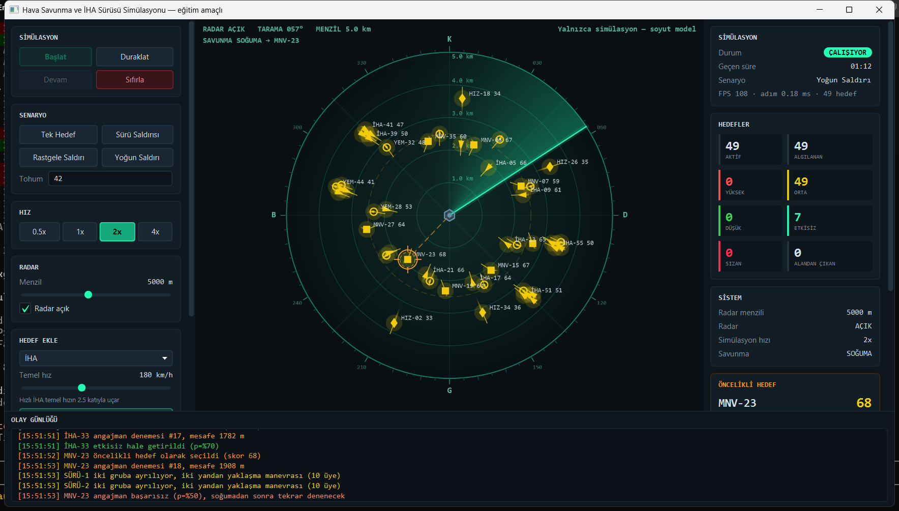

# Akıllı Hava Savunma ve İHA Sürüsü Simülasyonu

Java 21 ve JavaFX 21 ile yazılmış, **eğitim ve simülasyon amaçlı** bir masaüstü uygulaması. Radar ekranında farklı türde İHA'lar ve bir İHA sürüsü hareket eder. Radar bu hedefleri tarayarak algılar. Sistem her hedef için bir tehdit skoru hesaplar, hedefleri önceliklendirir ve soyut bir savunma durum makinesiyle karar sürecini görselleştirir.

> ⚠️ Bu proje gerçek bir askeri sistemin modeli değildir. "Savunma" kısmı soyut bir durum makinesi ve olasılıksal bir karar modeli olarak kurgulanmıştır. Gerçek silah, balistik ya da güdüm hesabı içermez.



---

## Özellikler

- Dönen sweep'li radar ekranı: menzil halkaları, kerteriz (derece) halkası, iz efekti, algılama anında "ping"
- 4 hedef türü, her biri ayrı şekille çizilir: **İHA** (üçgen), **Hızlı İHA** (elmas), **Manevralı İHA** (kare), **Yem / Decoy** (halka)
- **Boids** algoritmasıyla hareket eden ve periyodik olarak ikiye bölünüp iki yandan yaklaşan İHA sürüsü
- 5 bileşenli, ağırlıklı **tehdit skoru**. Seçili hedefin panelinde bileşen çubukları gösterilir.
- Comparator zinciriyle **önceliklendirme** ve ilk 5 listesi
- **Savunma durum makinesi**: `IDLE → SELECTING → TRACKING → ENGAGING → COOLDOWN`
- 4 senaryo, sabit **seed** ile tekrarlanabilir
- Renklendirilmiş, otomatik kayan ve 500 satırla sınırlı olay günlüğü
- Hedef seçimi, tahmini rota, kilit halkası, FPS ve tick süresi göstergesi

## Gereksinimler

- **JDK 21**
- Maven kurulumu **gerekmez**. Proje Maven Wrapper (`mvnw` / `mvnw.cmd`) ile gelir ve ilk çalıştırmada Maven'ı kendisi indirir.

## Çalıştırma

```bash
# Windows
mvnw.cmd javafx:run

# macOS / Linux
./mvnw javafx:run
```

Testler:

```bash
mvnw.cmd test
```

## Kullanım

| Kontrol | Açıklama |
|---|---|
| **Başlat / Duraklat / Devam / Sıfırla** | Simülasyon durumunu yönetir. Butonlar duruma göre aktif veya pasif olur. |
| **Senaryo** | Tek Hedef, Sürü Saldırısı, Rastgele Saldırı, Yoğun Saldırı. *Tohum* (seed) alanı tekrarlanabilirliği sağlar. |
| **Hız** | 0.5x / 1x / 2x / 4x. Çarpan simülasyonun `dt` değerine uygulanır. |
| **Radar** | Menzil slider'ı (1–10 km) ve radar aç/kapa |
| **Hedef Ekle** | Tür ve temel hız seçip rastgele bir yönden hedef ekler |
| **Görünüm** | İzler, tahmini rota ve etiketler |
| **Fare** | Hedefe tıklayınca seçilir ve bilgi paneli açılır. Boş alana tıklayınca seçim kalkar. |
| **Space / R** | Başlat-duraklat / sıfırla |

Renkler: **yeşil** DÜŞÜK, **sarı** ORTA, **kırmızı** YÜKSEK, **soluk gri** henüz algılanmamış hedef.
Turuncu kesikli halka angajman menzilini (2500 m), kırmızı noktalı halka sızma yarıçapını (100 m) gösterir.

---

## Mimari

```text
┌──────────────────────────── JavaFX Application Thread ────────────────────────────┐
│  App ─▶ MainController ─┬─ ControlPanel ──(komut)──┐                              │
│                         ├─ StatsPanel / TargetInfoPanel ◀─┐                       │
│                         ├─ LogPanel ◀── Platform.runLater(batch)                  │
│                         └─ AnimationTimer ─▶ RadarRenderer ─▶ Canvas             │
└─────────────────────────────────────│─────────────────────│───────────────────────┘
                                      │ ConcurrentLinkedQueue│ AtomicReference
                                      ▼ (komutlar)           │ <SimulationSnapshot>
┌──────────────── simulation-loop (ScheduledExecutorService, 60 Hz) ────────────────┐
│  SimulationEngine.tick()                                                          │
│    1. komutları uygula   2. zamanlanmış spawn'lar   3. Radar.update (sweep)      │
│    4. DroneSwarm.update (Boids)   5. Target.update(dt) (polimorfik)              │
│    6. algılama / kayıp / sızma    7. tehdit hesabı ──▶ threat-worker havuzu      │
│    8. PriorityService             9. DefenseSystem (durum makinesi)              │
│   10. immutable SimulationSnapshot üret ──────────────────────────────────────────┘
│                    │ EventBus.publish (Observer)
└────────────────────┼──────────────────────────────────────────────────────────────┘
                     ▼
        EventLogger ── BlockingQueue ──▶ event-logger thread ──▶ batch ──▶ UI
```

### Paket yapısı

| Paket | Sorumluluk |
|---|---|
| `model` | `Target` (sealed, abstract) ve alt sınıfları, enum'lar, `ThreatResult`, `TargetFactory`, `Geometry`. JavaFX'e bağımlı değildir. |
| `swarm` | `DroneSwarm` (Boids), `SwarmConfig` |
| `radar` | `Radar`: menzil ve sweep tabanlı algılama |
| `service` | `ThreatAssessmentService`, `PriorityService`, `DefenseSystem` |
| `config` | `ThreatConfig`, `DefenseConfig`, `SimulationConfig`. Tüm sayısal parametreler burada tutulur. |
| `simulation` | `SimulationEngine`, `SimulationState`, `SimulationSnapshot` |
| `scenario` | `Scenario` arayüzü ve 4 senaryo |
| `event` | `SimulationEvent`, `EventBus`, `EventLogger` |
| `view` | `RadarRenderer`, `CoordinateMapper`, paneller |
| `controller` | `MainController` |

### Concurrency

- Her hedef için ayrı bir thread açılmaz. Tek bir **simülasyon döngüsü** (`ScheduledExecutorService`) vardır.
- Tehdit hesapları sabit boyutlu bir havuzda `invokeAll` ile **paralel** yapılır.
- Model nesnelerini yalnızca simülasyon thread'i değiştirir. Arayüzden gelen istekler bir komut kuyruğuna eklenir ve tick başında uygulanır.
- Arayüz her karede yalnızca `AtomicReference<SimulationSnapshot>` içindeki en son değiştirilemez durumu okur. Bu yüzden kilit gerekmez.
- Log, ayrı bir thread'de `BlockingQueue`'dan tüketilir ve toplu olarak tek bir `Platform.runLater` ile arayüze aktarılır.
- Kapanışta tüm executor'lar `shutdown` + `awaitTermination` ile kapatılır.

---

## Algoritmalar

### Koordinat sistemi

Dünya metre cinsindendir ve radar merkezi (0, 0) noktasındadır. +x doğuyu, +y kuzeyi gösterir. Yön 0° kuzeydir ve saat yönünde artar. Hız m/s olarak saklanır ve arayüzde km/h olarak gösterilir. Ekrana dönüşümü `CoordinateMapper` yapar.

### Radar algılama

Bir hedef **menzil içindeyse ve son tick'te sweep çizgisi hedefin kerterizinden geçtiyse** algılanır. Böylece animasyon ile algılama mantığı tutarlı kalır. Sweep 4 saniyede tam tur atar. Algılanmış bir hedef menzil dışına çıkarsa `TARGET_LOST` olayı yayınlanır ve hedef **KAYIP** olarak işaretlenir.

### Tehdit skoru

```text
Threat Score = 100 × Σ (ağırlık_i × bileşen_i)        Σ ağırlık = 1
```

| Bileşen | Hesap (0–1) | Ağırlık |
|---|---|---|
| distance | `1 − mesafe / menzil` | 0.30 |
| speed | `hız / 150 m/s` | 0.15 |
| direction | `max(0, cos θ)`: hız vektörü ile merkeze olan vektörün kosinüs benzerliği | 0.20 |
| timeToImpact | `1 − TTI / 120 s`, burada `TTI = mesafe / (hız · cos θ)` | 0.20 |
| type | İHA 0.60, Hızlı İHA 0.85, Manevralı İHA 0.80, Yem 0.10 | 0.15 |

Seviyeler: `0–30 LOW` (DÜŞÜK), `31–70 MEDIUM` (ORTA), `71–100 HIGH` (YÜKSEK). Skor eşiğin etrafında salınırken seviyenin sürekli değişmemesi için 3 puanlık bir histerezis uygulanır.

### Önceliklendirme

```java
Comparator.comparingDouble(Target::getThreatScore).reversed()   // 1. skor (azalan)
        .thenComparingDouble(Target::getTimeToImpact)             // 2. varış süresi (artan)
        .thenComparingDouble(distanceToCenter)                    // 3. mesafe (artan)
        .thenComparing(Target::getId);                            // deterministik sıra
```

### Boids (sürü)

Her üye için komşuluk yarıçapı içindeki aynı gruptaki üyelerden dört kuvvet hesaplanır ve ağırlıklı toplamı alınır:

- **Separation**: çok yakın komşulardan uzaklaşma
- **Alignment**: komşuların ortalama hız yönüne hizalanma
- **Cohesion**: komşuların ağırlık merkezine yönelme
- **Goal seeking**: radar merkezine ya da manevra sırasında grubun ara noktasına yönelme

Sürü belirli aralıklarla **ikiye bölünür**. İki grup, yaklaşma doğrultusunun iki yanındaki ara noktalara gider ve ardından merkeze yeniden yönelir.

### Savunma durum makinesi

```text
IDLE ──(öncelikli hedef var)──▶ SELECTING ──(0.3 s)──▶ TRACKING
TRACKING ──(takip ≥ 2 s ve mesafe < 2500 m)──▶ ENGAGING
ENGAGING ──(0.6 s, olasılıksal sonuç)──▶ COOLDOWN (1.2 s)
COOLDOWN ──(hedef hâlâ geçerli)──▶ TRACKING  |  ──(değil)──▶ IDLE
```

Başarı olasılıkları `DefenseConfig` içinde tutulur: temel %70, hızlı hedef %45, manevralı hedef %50. Başarısız denemeden sonra cooldown süresi beklenir ve hedef yeniden denenir. Takip sırasında skoru belirgin şekilde daha yüksek bir hedef çıkarsa (15+ puan) hedef değiştirilir. Merkeze 100 m'den fazla yaklaşan hedef **ESCAPED** (SIZDI) sayılır.

Arayüzde durumlar Türkçe gösterilir: `IDLE` BEKLEMEDE, `SELECTING` HEDEF SEÇİYOR, `TRACKING` TAKİP, `ENGAGING` ANGAJMAN, `COOLDOWN` SOĞUMA.

---

## Tasarım desenleri

| Desen | Nerede |
|---|---|
| **Observer** | `EventBus`, `EventListener`, `EventLogger` |
| **Strategy** | `Scenario` arayüzü ve 4 senaryo uygulaması |
| **State** | `DefenseSystem` + `DefenseState`; ayrıca `SimulationState` ve `TargetStatus` |
| **Factory** | `TargetFactory`: türe göre doğru `Target` alt sınıfını üretir |
| **Template / polimorfizm** | `Target.update(dt)`: her alt sınıf kendi hareket modelini uygular |
| **Immutable snapshot** | `SimulationSnapshot` record'u ile thread'ler arası durum aktarımı |

## Testler

`src/test/java/com/simulation/airdefense/` altında JUnit 5 ile yazılmış 43 test var:

- `RadarTest`: menzil içi/dışı, sınır değeri, radar kapalıyken algılama, sweep'in hedefin üzerinden geçmesi, kuzeyde 360°→0° geçişi
- `ThreatAssessmentServiceTest`: 0–100 aralığı (5000 rastgele hedef), seviye eşikleri, histerezis, Yem < İHA, ağırlıklı toplamın doğruluğu, paralel ve sıralı hesabın aynı sonucu vermesi
- `PriorityServiceTest`: skor sıralaması, eşitlikte TTI ve mesafe, sonsuz TTI, filtreleme, değiştirilemez liste
- `SimulationEngineTest`: Tek Hedef senaryosunun arayüzsüz sonuna kadar çalışıp her hedefin bir sonuca (etkisiz / sızdı / alandan çıktı) bağlanması; Rastgele Saldırı senaryosunun aynı seed ile 16x ve 32x hızda birebir aynı sonucu vermesi

---

## Geliştirici

[Goktugelbir](https://github.com/Goktugelbir)
